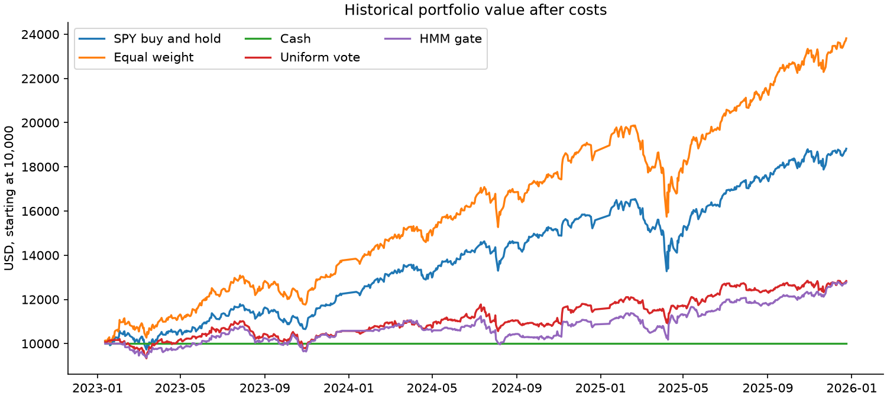

# ML-TradeEngine

An experimental quantitative research and **local paper-trading** system. It
compares directional classifiers and trading rules, records reproducible
experiments, and replays a portfolio with shared simulated capital.

**No durable trading edge or prospective broker-paper track record is established.**
Historical results before the September 2026 repairs are invalid for strategy
promotion. See the [completed repair report](docs/REPAIR_REPORT_2026-09-28.md),
[repair evidence and limitations](docs/REPAIR_CHECKLIST.md),
[research protocol](docs/PROSPECTIVE_PAPER_PROTOCOL.md), and the
[original audit](docs/REPOSITORY_AUDIT_2026-09-27.md).

## Ensemble Lab

[Open the private simulation website](https://ceci2-ensemble-lab.breezytoad67.chatgpt.site). Choose a date and instrument under Controller to see how each expert voted and how much weight it received. Architecture follows the decision through execution and research review. Stress tests compare the adaptive controller with an equal vote under changes in market conditions and expert availability.

In the separate 2022–2025 study, the adaptive controller earned 26.95% after costs and the equal vote earned 14.35%. Their return difference had a 95% interval from −28.93 to +48.64 percentage points. [Read the stress study](data/ceci2-demo/robustness/README.md).

To serve the website locally or inspect the recorded Amazon decision that produced a simulated purchase on February 3, 2023, run the corresponding command from the repository root.

```sh
python3 -m http.server 8765 --directory site
python3 -m ceci2_demo.trace 2023-02-02 --symbol AMZN
```

## Run the CECI2 study

[Open the Colab demo](https://colab.research.google.com/github/Yash789k/ML-TradeEngine/blob/main/ceci2_demo/experiment.ipynb) or follow the [local training instructions and data guide](ceci2_demo/README.md). The demo includes trained model weights, forecasts, daily portfolio histories and the underlying simulated orders.

Across 719 evaluation sessions in 2023–2025, the regime-weighted ensemble earned 27.68% after costs. Holding SPY at the same daily equity exposure earned 35.45%. Equal weighting across the fixed 22-instrument universe earned 138.16%. The fixed ensemble earned 28.30%. The paired 95% block-bootstrap interval for the adaptive gate’s cumulative return advantage over the fixed ensemble spans −21.19 to +19.99 percentage points. [Full results and limitations](ceci2_demo/RESULTS.md)



## Archived prototype and pilots

The sections below describe earlier studies and their original machine-specific commands. For a fresh checkout use the CECI2 study above.

### Historical five-session pilot

Use the isolated week-one collector and `app_week1.py` for current work. The study
contains 848 registered training trials, a complete clean-environment reproduction,
capital-matched diagnostics and a substantial generated manuscript. Results do
not establish a trading edge. External broker orders remain disabled.

```bash
data/research-v2/clean-env/bin/python -B data/releases/research-v2-runtime-20260928-week1/scripts/collector_v2.py status --release data/releases/research-v2-runtime-20260928-week1 --workspace data/paper/research-week1
python -m streamlit run app_week1.py --server.port 8504
```

The local launch agent checks exchange-calendar events every minute. The first
registered decision is 29 September 2026; normal close+30 appears in Hong Kong
at 04:30 the following day during US daylight time, 05:30 during standard time.
The host must remain awake and logged in. Commissioning observations do not
count as prospective evidence. At the user's request, the active trial now ends
after five decision sessions: operational review on 6 October at 05:30 HKT,
with outcome-only follow-up through 14 October at 04:30 HKT. The original
63-session release and workspace are preserved and superseded.
See [execution status](docs/research-week1/STATUS.md),
[operation and recovery](docs/research-week1/OPERATIONS.md),
[editable LaTeX manuscript](output/overleaf/week1/main.tex), and
[research PDF](output/pdf/ML_TradeEngine_Research_Week1.pdf).

### Preserved v1 rolling release and console

The following describes the earlier v1 release. Its commands, evidence and
artifacts are retained for reproduction; use the v2 instructions above for
the active collector and its separate account state.

The current release uses fresh public observations through **25 September
2026**, a registered rolling logistic/tree hybrid, and the shared account.
See [current readiness](docs/ADAPTIVE_RELEASE_READINESS.md) and the
[complete research manuscript](docs/ADAPTIVE_RESEARCH_PAPER.md).
The selected trend shadow and hybrid failed the recent historical edge gate;
the eligible deployment account therefore holds cash.

```bash
python trader.py verify
python trader.py daily
python -m streamlit run app.py
```

`daily` downloads into a new session snapshot, checks all instruments, loads
sealed models, retrains every 21 observed sessions, records probabilities and
targets, and advances local deployment/shadow ledgers from the reserved pilot
start. Before 29 September it runs a commissioning preview. Run it after each
completed US session and before the following close; it rejects missing daily
events instead of backfilling. This command submits no external orders. A
verified snapshot can be supplied with `--snapshot PATH` for an offline rerun
on the same session. No unattended local scheduler was installed.

The current UI is `app.py`; `dashboard.py` remains the legacy research viewer.
Snapshots, models, account state, source and evidence are under
`data/releases/2026-09-28-adaptive` and `data/paper/adaptive-v1`. They are local,
gitignored artifacts; copying code alone does not copy a ready release.

To repeat the frozen study without fresh downloads or changed parameters:

```bash
python scripts/reproduce_adaptive.py --release data/releases/2026-09-28-adaptive --output data/releases/my-reproduction
```

Do not overwrite a release or reuse the audit to optimize a new winner. New
research needs a new recorded protocol and independent evaluation period.

### Earlier repaired research tools

Python 3.13 is the verified local interpreter; Python >=3.12 is required by
pandas-ta. In this workspace the working interpreter is
`/Users/a/miniconda3/bin/python`.

```bash
python -m pip install -r requirements.txt
python -m pytest tests/ -q
python scripts/local_sandbox.py --output data/repairs/my-bootstrap --capital 10000
```

The sandbox creates new model artifacts, performs three-model sequence
inference, exercises local orders/fills, and verifies persistence and account
reconciliation. It uses synthetic prices and is an operational test. It makes
no broker or alert calls. Each experiment output directory must be new.

To rerun corrected historical research from the repository's frozen local bars:

```bash
python scripts/validated_research.py --output data/repairs/my-research --ml --trials 3 --epochs 10
python scripts/replay_portfolio.py --research data/repairs/my-research --output data/repairs/my-portfolio --capital 10000
python scripts/operational_status.py
```

The research runner preserves input snapshots, code, package versions, protocol,
model bundles, signals, ledgers, metrics, cost stress tests and hashes. It trains
through 2023, selects on 2024, and measures exploratory historical outcomes from
2025 on matching observed sessions. That history has already been inspected;
it is **not an untouched final holdout**. Macro, sentiment and crypto features
without sufficient historical evidence are excluded and recorded.

For fresh market-data signal validation (public provider reads, still no orders):

```bash
python scripts/bootstrap_models.py
python live.py run --dry-run
```

`python live.py run --capital 10000 --state data/local-paper/account.sqlite`
advances the **local simulated account**, including fills of earlier pending
orders. It does not submit to Alpaca. A missing signal, stale input or invalid
model bundle fails the batch. The scheduled workflow performs tests, artifact
bootstrap and signal dry runs; running that workflow remotely remains unverified.

## Execution and accounting

- Decisions use completed close information; fills use the next observed close.
- One cash/position account governs all symbols and strategy allocations.
- UP moves toward a target weight. FLAT and DOWN target zero in long-only mode.
- Pending buys reserve cash. Pending sells are not spendable cash until filled.
- Gross, per-symbol, turnover and configured exposure-group caps govern orders.
- Fees and modeled slippage are cash charges on reference-price notional.
- Daily equity equals cash plus marked holdings. Closed P&L includes entry and
  exit costs. Terminal positions remain marked; no hidden liquidation occurs.
- Shared execution supports fractional long-only equities/ETFs, no leverage and
  no bracket orders. The legacy short and stop/Kelly simulators are separate
  exploratory tools, not a description of prospective broker behavior.
- SQLite stores decisions, orders, partial fills, cancellations, rejections and
  account state atomically. Duplicate IDs validate identical content; competing
  stale writers fail closed.

Research replay and local paper execution use the same event handler in
`src/execution/account.py`. External broker timing, recovery and reconciliation
must be validated separately before an authorized prospective trial.

## Research conventions

Daily metrics use 252 sessions and a fixed 5% annual excess-return hurdle; idle
cash earns zero. Sortino uses target-relative downside deviation. Drawdown
includes initial capital. Alpha regresses excess returns. The fixed hurdle is
not a historical Treasury series. Constant-return Sharpe is reported as zero by
convention. Trade win rates refer to closed net outcomes, not open holdings.

HMM parameters fit a fixed initial window; later states use forward filtering.
Supervised selection and weights fit training folds only. Labels become usable
after their full forward horizon. LSTM warm-up is unavailable rather than a
fabricated uniform forecast. Confidence thresholds and cost stress cases are
predeclared. Signed HAC evidence, block-bootstrap uncertainty and Bonferroni
adjustments prevent a reliably negative or multiply searched result from being
promoted as a discovery. Mean per-ticker metrics are never account performance.

## Status and architecture

`observed data → causal features → purged training → sealed model bundle → target
weights → shared account → local fills → reconciliation → reproducible report`

Accounting, causal transformations, local target execution and restart recovery
have regression evidence. Strategy eligibility, fresh production inputs, remote
CI, a broker adapter, sustained prospective evidence and publication claims have
separate gates. A positive simulation or a passing test suite is insufficient.

The eight existing zoo classes remain available. Reports name the momentum rule
as time-series momentum, the pairs implementation as a single relative-value
long leg, and macro-unavailable carry as an SMA trend fallback. These are not
cross-sectional selection, a hedged pair, or measured carry returns.

The historical README and paper are preserved under `docs/archive/`. Original
build logs remain historical records; the repair checklist supersedes their
readiness claims. Network-provider tests are explicitly separated:

```bash
python -m pytest tests/test_data_pipeline.py -m integration -q
```

Provider integration and prospective broker execution were not performed during
these repairs. Supplementary-data admission and later trial gates are documented
in [the prospective protocol](docs/PROSPECTIVE_PAPER_PROTOCOL.md).

[Compare all approaches by period](https://ceci2-ensemble-lab.breezytoad67.chatgpt.site/#comparison). The comparison includes annual and quarterly results, an equity curve for each portfolio with complete data in the chosen window, and the individual expert votes behind the custom neural mixture. The Colab T4 study contains the GPU-trained models and their daily decisions. [Training notebook and artifacts](data/ceci2-demo/colab-t4-v1/README.md).

[Read the illustrated model comparison](site/assets/ensemble-study.pdf) for a guide to the forecasters, the models that choose among them, and how their portfolios performed across market periods.
