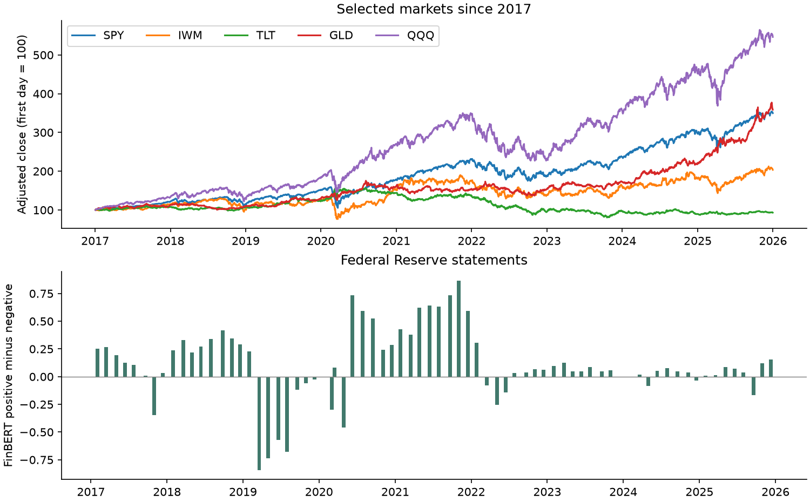
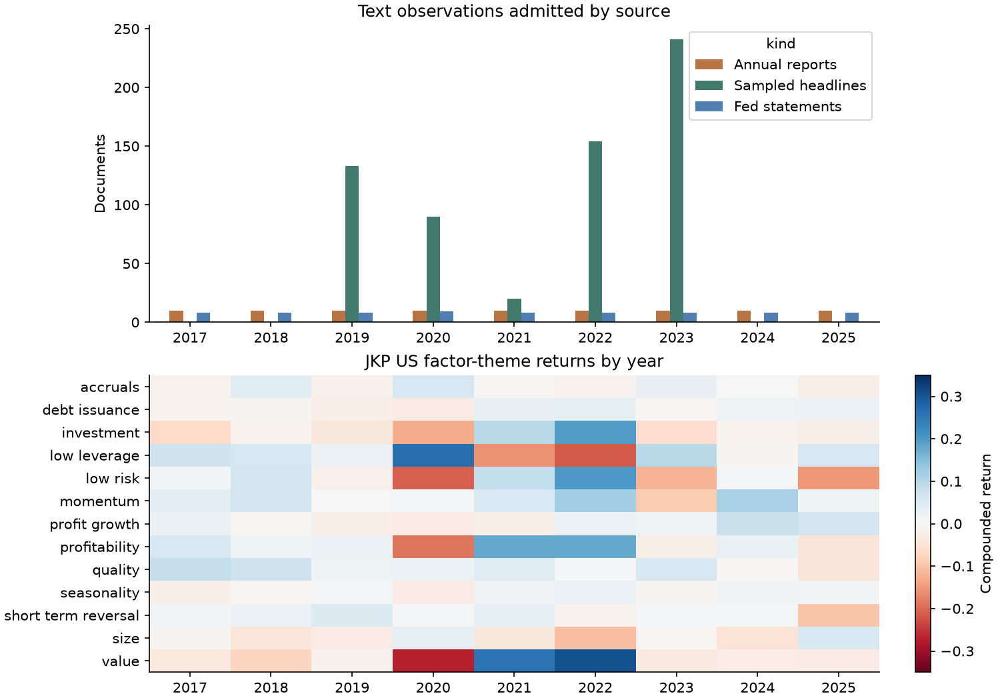
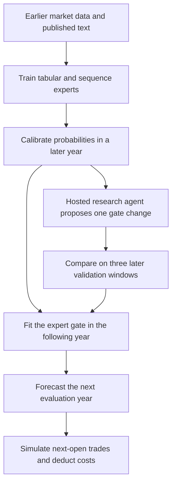

# CECI2 research demo

The experiment predicts whether each stock or fund will rise, stay flat or fall between the next opening price and the opening price five sessions later. Each model sees the same instrument dates and outcomes. The one-session study refits the classifiers with a shorter target.



## Run the demo

Use Python 3.12. On macOS the LightGBM wheel needs Homebrew's `libomp`. From the repository root, run the following commands to reconstruct a forecast from the checked-in model weights. The printed result includes every expert's weight and the final probabilities.

```bash
python3.12 -m venv .venv
source .venv/bin/activate
python -m pip install -r ceci2_demo/requirements.txt
python -m ceci2_demo.predict data/ceci2-demo/five-session/models-2025
```

To train the full study, choose an empty output directory. The first run downloads market history and the public factor archive. It uses checked-in text scores and recorded agent proposals. No API key is required. Add `--horizon 1` with a different output directory to repeat the sensitivity study.

```bash
python -m ceci2_demo.run --output data/raw/my-five-session-run
```

Open the [Colab notebook](https://colab.research.google.com/github/Yash789k/ML-TradeEngine/blob/main/ceci2_demo/experiment.ipynb) to explore the evidence or retrain on a hosted Python runtime.

## Data and timing

| Input | Sample and use |
|---|---|
| Daily market bars | 2,262 sessions per instrument from January 2017 through December 2025. The fixed universe contains 22 US-traded stocks and ETFs. The reader requires one unique positive OHLCV observation for every expected NYSE session. The registered run fixes the vendor's observed adjusted-close ratios. Unadjusted bars still come from the publisher. Use `--refresh-adjustments` for a new vendor vintage. |
| JKP factor themes | The factor classifier uses 13 U.S. capped-value-weighted theme returns. Each feature compounds 21 sessions and lags the result by a further 21 sessions. The factor portfolios are market-wide academic series. [Global Factor Data](https://jkpfactors.com/data) |
| Annual reports | 90 Form 10-K excerpts across ten issuers. The collector uses EDGAR acceptance timestamps. FinBERT scores the management discussion excerpt or the documented business-narrative fallback. The score expires after 370 days. [SEC EDGAR](https://www.sec.gov/search-filings/edgar-application-programming-interfaces) |
| Company headlines | 638 observed headlines across six issuers in the Nasdaq-100 subset. The sampler takes the first timestamped, deduplicated headline per issuer and ISO week. Scores expire after seven days. Coverage is sparse after 2023. [FNSPID data release](https://huggingface.co/datasets/benstaf/FNSPID-nasdaq-100-post2019-1newsperrow) |
| Fed statements | 73 public statements. Features become eligible on the first trading date strictly after publication. The dataset keeps the release line, source URL and text. [Federal Reserve calendars](https://www.federalreserve.gov/monetarypolicy/fomccalendars.htm) |
| Language decisions | FinBERT supplies financial sentiment. Qwen2.5-0.5B-Instruct and Granite 3.1 1B-A400M score three constrained answer tokens. The OpenAI Decisions API supplies the structured alternative to Jev. It scored the same 73 statements and 107 monthly packets with anonymized information about all 22 instruments. Monthly scores persist to the next refresh. The remote model name and token usage accompany each response. [Decisions API](https://developers.openai.com/api/docs/guides/decisions) |



Company data uses the first trading date strictly after the UTC publication date. A zero tone with a missingness flag records absent text. Market data and factors are current-vintage histories. The pretrained models were released after some evaluation dates, and their training corpora may contain historical events. These language comparisons are retrospective. The fixed universe includes surviving large firms and overlapping ETFs.

## Training and evaluation



For evaluation year Y, expert training ends in Y−3, temperature calibration uses Y−2, and gate fitting uses Y−1. The runner removes samples whose labels mature outside their block and skips the first five eligible sessions of each calibration, gate and evaluation year. The volatility multiplier is fixed at 0.5. The cutoff for FLAT is the greater of round-trip cost and this multiplier times trailing volatility scaled to the horizon. Holding five-session forecasts does not mandate a five-session position. The portfolio can rebalance each session.

Seven market experts train from scratch in each fold. Logistic regression and both boosted tree models consume daily features. LSTM, GRU, a dilated temporal convolution and a compact patch Transformer consume 20-session windows. The FinBERT logistic classifier and the JKP classifier train on their respective features. Four pretrained language forecasts complete the 13-expert pool. Each model's temperature is fitted on held-out calibration rows. The resulting static vote gives each expert equal weight.

The gate estimates each expert's probability of being correct and normalizes those estimates across experts. Context includes trailing volatility, market movement, text and prior accuracy. Accuracy feedback is grouped by label maturity date. The HMM version adds forward-filtered state probabilities from a three-state Gaussian model fitted to a preceding 504-session market window. The regime comparison holds the expert pool and execution policy fixed.

The simulated account starts with $10,000. It chooses at most five instruments whose UP probability exceeds their DOWN probability by more than 0.05. Within that group, inverse volatility sets the relative sizing, subject to a 15% position cap. Exact score ties follow alphabetical ticker order. This matters for market-wide forecasts and the training-prior baseline. All strategies pay five basis points per side on actual changes in holdings. Folds liquidate at their last evaluated opening, carry cash across the excluded sessions and resume in the next fold. The SPY benchmark therefore has three entries and exits. Cash earns zero.

The dynamic policy also applies exposure buckets and adjusts the entry threshold during regime changes. A trailing stop uses closing observations and acts at the next open. The account reduces risk following a 10% drawdown and caps order size at 1% of the previous session's dollar volume. These are simulated fills in adjusted-price units. The archived collector and its persistent account have separate execution assumptions.

## Research agent

The OpenAI Agents API runs a managed review session. It receives only earlier calibration scores and proposes one of five permitted gate regularization strengths. Every session has a US$0.50 spend limit. The local evaluator trains the candidate on the first part of the gate year. It compares that candidate with the incumbent over three subsequent two-month blocks under matching costs, including an embargo and a purge based on label maturity. The evaluator requires improved Sharpe in all three blocks, a positive lower bootstrap bound, bounded drawdown and expected shortfall, and at least 30 executions. An accepted setting first affects the following evaluation year. The conventional and seeded-random controls each receive one proposal. [Agents API](https://developers.openai.com/api/docs/guides/agents-api/overview)

Each fold saves its own fitted models. The receipts distinguish a live API proposal from replay of a previously recorded proposal. To commission new proposals, supply `--hosted-review` and use a new cache directory or remove only the previously recorded local proposal for the same inputs. A new hosted run prompts for the key with hidden input when the environment lacks `OPENAI_API_KEY`.

A source rebuild of the text features uses a fresh cache, the approved SEC contact email in `SEC_CONTACT`, and `--rebuild-text`. It downloads both open language models and FinBERT. To regenerate the paid structured decisions, first populate the text and market cache, then run `python -m ceci2_demo.decisions CACHE` and `python -m ceci2_demo.digests CACHE`. These commands save each response individually for resumption.

## Evidence

The [five-session results](../data/ceci2-demo/five-session) and [one-session results](../data/ceci2-demo/one-session) include individual probabilities, reconciled daily portfolio values, a dynamic order ledger, calibration and training cutoffs, and the full configuration. The costs table reruns execution at four fee levels. The regime table groups returns along the original account path. The confidence intervals resample paired dates in 20-session blocks within year. Cross-sectional ticker rows and overlapping labels do not count as independent observations.

The replication uses simulated accounts. An October-to-April prospective record requires observations from those dates. The earlier pilot has its own [closeout record](../docs/research-outcomes-r7/STATUS.md). Several archived validation directories refer to a separate release that was stored on the original research machine. The commands above use the versioned inputs in this repository and the public sources listed above.

To inspect simulated fills at a particular historical opening, run the following command. It reconstructs holdings and cash from individual signed quantities, prices and fees.

```bash
python -m ceci2_demo.paper 2025-04-08
```
