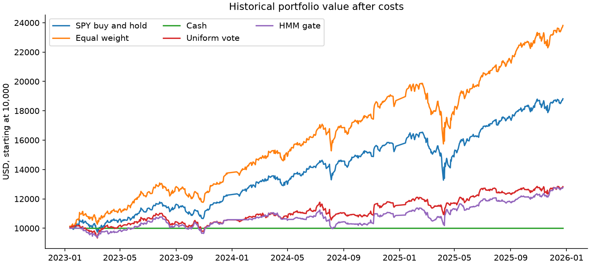

# Results on the proposal’s opening-price target

The adaptive ensemble earned 27.68% after costs across the three historical evaluation windows. A fixed vote over the same experts earned 28.30%. The data do not establish an advantage from regime-dependent weighting.

| Five-session model or portfolio | Accuracy | Log loss | Net return | Maximum drawdown | Sharpe | Average equity exposure |
|---|---:|---:|---:|---:|---:|---:|
| HMM gate | 40.90% | 1.0796 | 27.68% | 11.34% | 0.81 | 62.15% |
| Gate without HMM | 41.02% | 1.0769 | 28.32% | 12.87% | 0.80 | 60.00% |
| Fixed vote over all experts | 40.42% | 1.0777 | 28.30% | 11.21% | 0.80 | 66.84% |
| Fixed vote over seven market experts | 43.92% | 1.0713 | 21.54% | 14.78% | 0.69 | 47.60% |
| SPY at the HMM gate’s daily equity exposure | | | 35.45% | 13.90% | 1.08 | 62.15% |
| SPY held during each evaluation window | | | 88.21% | 19.77% | 1.47 | 100.00% |
| Daily equal weight across 22 instruments | | | 138.16% | 20.78% | 1.84 | 100.00% |
| 21-session momentum | | | 73.01% | 12.96% | 1.50 | 54.88% |
| Cash | | | 0.00% | 0.00% | 0.00 | 0.00% |

The comparison covers 15,818 stock-date observations on 719 common sessions. Fees were five basis points per side. Sharpe annualizes the mean and standard deviation of evaluated daily returns using 252 sessions and a zero cash rate. The return column compounds across all three windows. The equal-weight portfolio benefits from the hindsight-selected universe and its overlapping technology exposure. [All models and benchmarks](../data/ceci2-demo/five-session/comparison.csv)

The gate’s return trailed exposure-matched SPY in 2023 and 2024. In 2025 it earned 17.48%, compared with 16.38% for exposure-matched SPY. The 95% interval for the gate’s cumulative return difference versus the fixed vote spans −21.19 to +19.99 percentage points. Its log-loss difference also spans zero. A five-basis-point charge per side cost the gate $1,284 over the study. At 20 basis points per side the same policy lost 10.41%. The dynamic risk policy returned 12.23% with a 13.27% drawdown. [Annual results](../data/ceci2-demo/five-session/annual.csv) · [Cost sensitivity](../data/ceci2-demo/five-session/costs.csv) · [Paired intervals](../data/ceci2-demo/five-session/run.json)

The seven market experts had better probability accuracy as a fixed ensemble than the full pool in this sample. The stock-specific OpenAI digest had log loss of 1.7842, compared with 1.0788 for the historical class prior. Some language predictions assigned negligible probability to classes that occurred. A shared central-bank signal can also give identical scores across tickers. Alphabetical tie resolution and inverse-volatility sizing then contribute to the portfolio outcome. Apparent returns from a statement-only strategy should be interpreted with this mechanism in mind. [Forecasts](../data/ceci2-demo/five-session/predictions.csv.gz)

With one-session labels, the gate earned 50.64% with 42.08% accuracy, while the fixed ensemble earned 46.27%. Its paired return interval spans −23.24 to +29.53 percentage points. The one-session horizon has 731 eligible dates because labels mature sooner. Comparisons across horizons therefore use slightly different evaluation windows. [One-session comparison](../data/ceci2-demo/one-session/comparison.csv) · [One-session uncertainty](../data/ceci2-demo/one-session/run.json)

The hosted research agent retained the incumbent setting in each five-session review. Across the one-session reviews it proposed stronger regularization once, and the proposal failed the validation rule. One seeded random proposal passed the five-session rule for 2025. Its resulting three-window portfolio returned 26.78%. These experiments cover one-number changes to a retrained weighting model. A broader autonomous strategy search and prospective effectiveness remain open questions. [Five-session agent decisions](../data/ceci2-demo/five-session/adaptation.json) · [One-session agent decisions](../data/ceci2-demo/one-session/adaptation.json)

A second download returned small differences in the vendor's adjusted closes even though the raw quotes matched. With fresh adjustment factors the gate returned 25.80%. The repository now includes the adjustment ratios used by the registered run. Retraining with a new cache, new price downloads and those fixed ratios reproduced every portfolio return and trade count. One of 15,818 full-gate class decisions changed, with a mean log-loss difference below 0.000001.
