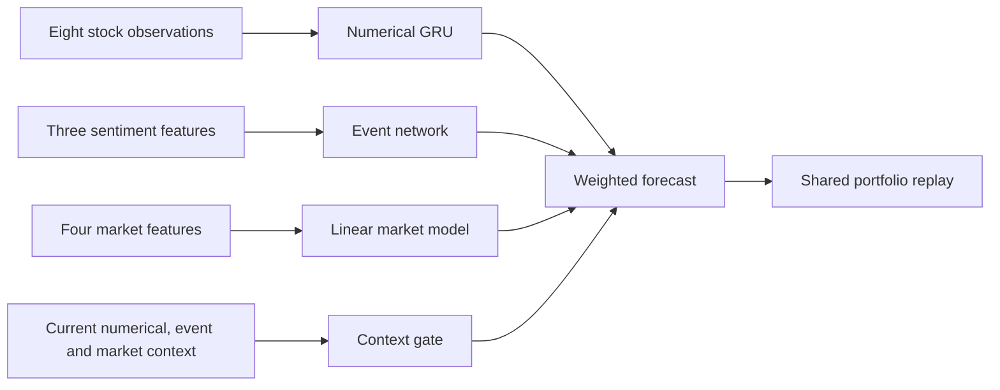

# Joint neural mixture

The three experts and the controller start from random weights in each fold. The first expert uses a gated recurrent unit over eight observations of the stock's market data. An event expert reads Federal Reserve, headline and filing sentiment from the recorded text features. A linear expert uses the broad market's return, volatility and breadth. The context gate gives the three expert forecasts a different weight at each stock's decision date.



The loss combines the mixture forecast's log loss with auxiliary supervision for each expert. The equal-vote control uses the same jointly trained experts. Both years had been examined in earlier research. On the CPU run the contextual vote returned 26.23% across the two evaluation years and the equal vote returned 53.23%. The contextual vote had 0.00132 higher mean daily log loss, with a paired 95% interval of −0.00701 to +0.00990.

| Evaluation year | Numerical GRU | Event network | Market model |
| --- | ---: | ---: | ---: |
| 2024 | 31.86% | 40.42% | 27.72% |
| 2025 | 45.29% | 24.64% | 30.06% |

These are average allocations across all instrument decisions that year. The text inputs are recorded sentiment features produced upstream. This experiment trains a small new encoder for those features.

From a checkout with the simulation dependencies installed, the following command fetches the pinned public training data. Supply a new output directory for each run.

```sh
python -m ceci2_demo.joint_v1.training --output /tmp/ceci2-joint --device cpu
```

In a Colab GPU runtime, the standalone Python file provides the same entry point. With the file saved as `training.py` in the notebook directory, run the following cell.

```python
from training import experiment

result = experiment("/content/ceci2-joint", device="cuda")
```

The full dated forecasts and per-instrument expert weights are saved alongside the trained weights, equity ledger, and training records. The runner caches public artifacts under `/tmp/ceci2-inputs`. To use a local copy of the registered input revision, pass its directory as `checkout`. CPU and GPU training may produce different results because the device controls shuffled minibatches and numerical kernels.

[Registration](protocol.json) · [CPU evidence](../../data/ceci2-demo/joint-v1/result.json) · [Daily portfolios](../../data/ceci2-demo/joint-v1/daily.csv.gz)
