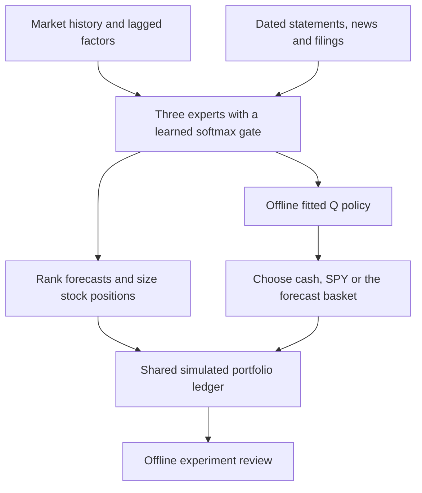
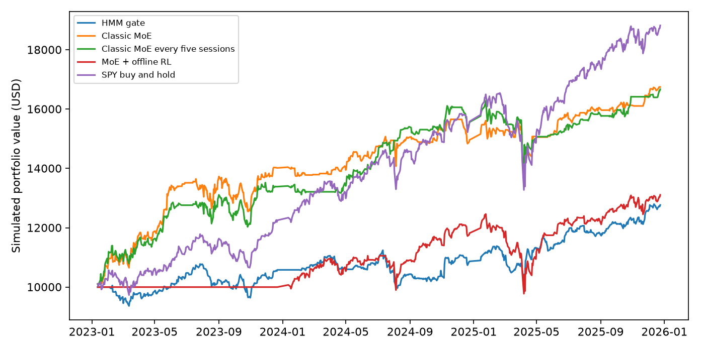

# Traditional mixture and offline allocation study

This experiment compares the original CECI2 controller with three multinomial experts and a softmax gate trained jointly. For each stock and date, the gate mixes distributions over down, flat and up. Its training loss is the negative log of the probability assigned to the observed class. Market inputs include past returns, volatility and lagged JKP themes. The qualitative inputs are FinBERT scores from the Federal Reserve, news and annual filings, the age of the Fed statement and indicators of company text coverage. OpenAI packet forecasts belong to the archived controller and are excluded from both classic mixture variants.

The [registered protocol](protocol.json) uses a separate year for temperature calibration and another for the reinforcement learning policy. In each annual test fold the learned weights stay fixed. The offline coding agent implemented and ran the registered comparisons. A production coding agent continually writing and activating policies would require a separately evaluated deployment process.



The decision to trade uses the closing information from the decision day. Orders fill at the next adjusted open. A position earns the change to the subsequent open. The reinforcement learner fits eight batches of Bellman targets using transitions reconstructed only from the preceding policy-training year. Its state includes the previous allocation choice. Training rewards deduct the cost of moving from drifted positions to each candidate and the cost of liquidating the final portfolio. This assumes small trades without market impact. Each policy starts with $10,000 and cash earns zero. Every reported portfolio uses the same ledger and pays five basis points per side.

## Evidence

[Portfolio results by year](../../data/ceci2-demo/moe-v2/comparison.csv) · [Forecast loss and text coverage](../../data/ceci2-demo/moe-v2/result.json) · [Daily decisions of the reinforcement learner](../../data/ceci2-demo/moe-v2/actions.csv)

The classic mixture earned 67.45% over 719 dates with 12.33% maximum drawdown. The original controller earned 27.68%. SPY with the classic mixture’s recorded daily exposure earned 27.85%, while buying SPY throughout each annual fold earned 88.21%. Rebalancing the classic mixture every five sessions earned 66.69% and reduced simulated fees from $1,653 to $512. This cadence experiment also changes holding periods and drawdown.

Removing qualitative inputs reduced the classic mixture's return to 23.30%. The largest difference arose in 2023; in 2025 the variant without text earned more. Exposure changed from 44.5% to 34.4%. Mean classification log loss improved slightly when text was removed. Only 7.2% of stock-date observations had company news within the seven-day window, while 45.4% had filing evidence within 370 days. The fixed seed and change in input dimension can yield different initial expert weights. These are two fitted systems, and this comparison cannot isolate the causal contribution of a single text source.

The original controller had lower forecast loss than the classic mixture. The signed difference was −0.0098, with a paired 95% interval from −0.0215 to +0.0010. The reinforcement learner earned 31.09% with 21.56% maximum drawdown. It held cash throughout the 2023 evaluation fold. SPY matched to its daily exposure earned 43.79%. Equal weighting across the same 22 assets earned 138.16%, illustrating the effect of the selected universe. All economic comparisons are descriptive. The evaluation dates had already been inspected, the portfolio contains overlapping ETFs and surviving stocks, and pretrained language models can postdate the historical decisions. No policy was promoted.



## Research behind the design

Jacobs and colleagues give the gating network and local experts a common training objective. Jordan and Jacobs extend the design to a hierarchy. Here the flat mixture supplies the main model baseline. Adding a second level would constitute another experiment. [Adaptive mixtures](https://www.cs.toronto.edu/~hinton/absps/jjnh91.pdf) · [Hierarchical mixtures](https://www.cs.toronto.edu/~hinton/absps/hme.pdf)

Gu, Kelly and Xiu examine both return forecasts and the portfolios built from them. DeMiguel and colleagues show why simple allocations deserve a place in portfolio comparisons. The study keeps equal voting among forecasts distinct from equal investment across assets. [Machine learning in asset pricing](https://academic.oup.com/rfs/article/33/5/2223/5758276) · [Naive diversification](https://academic.oup.com/book/16560/chapter-abstract/173272857)

Ernst and colleagues describe fitting successive value functions from historical transitions. Moody and Saffell incorporate trading costs into the learning objective. Together these motivate the separate policy-training year and rewards based on changes from the previous holding. [Fitted Q iteration](https://jmlr.org/papers/volume6/ernst05a/ernst05a.pdf) · [Learning to trade](https://pubmed.ncbi.nlm.nih.gov/18249919/)

Novy-Marx and Velikov report benefits from wider holding bands. Gârleanu and Pedersen derive gradual adjustment when trading is costly. Our five-session comparison tests a simpler way to reduce turnover. [Trading costs](https://www.nber.org/system/files/working_papers/w20721/w20721.pdf) · [Dynamic trading](https://nbgarleanu.github.io/DynTrad.pdf)

Tetlock and colleagues identify differences across news about fundamentals. Loughran and McDonald show how financial context changes the meaning of words in filings. A useful next qualitative experiment would isolate timestamped earnings and guidance revisions, register a decay window for each event type, and evaluate it on a new period. [Firm-specific news](https://business.columbia.edu/faculty/research/more-words-quantifying-language-measure-firms-fundamentals) · [Financial language in filings](https://doi.org/10.1111/j.1540-6261.2010.01625.x)

## Reproduce

Use the original five-session study's populated market cache and installed dependencies. Each invocation requires a new output directory and writes forecasts, the fitted weights, policy choices, daily portfolios and a comparison figure.

```sh
python -m ceci2_demo.moe_v2.study --output data/raw/moe-v2-reproduction
```
