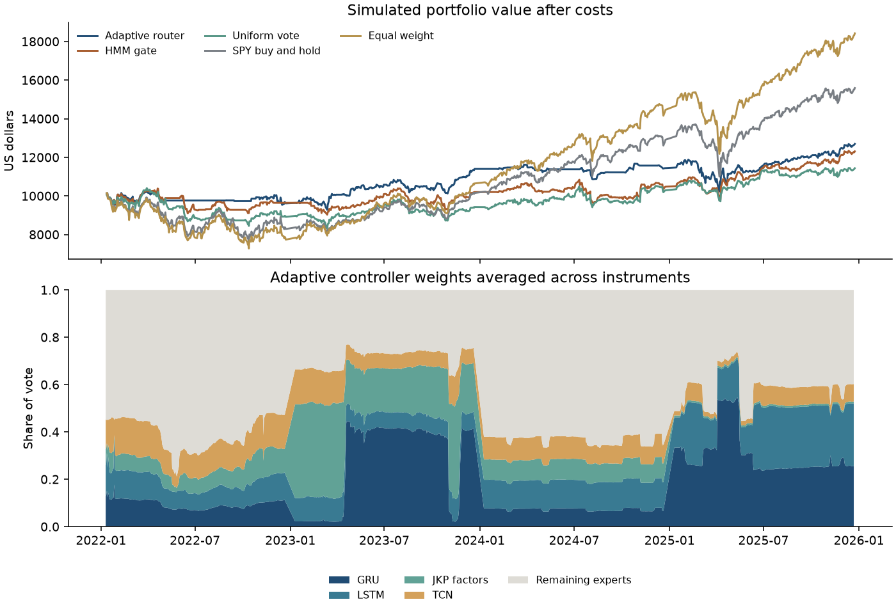

# Does adapting expert weights help when markets change?

Across 959 historical sessions from 2022 through 2025, the adaptive controller earned 26.95% after simulated costs. An equal vote among the same thirteen experts earned 14.35%. The paired 95% interval for the return difference spans −28.93 to +48.64 percentage points. Average forecast log loss improved by 0.00364, with a paired 95% interval for the signed change of −0.00791 to +0.00061. Both intervals include zero.



| Original forecasts | Net return | Maximum drawdown | Sharpe | 2022 net return |
| --- | ---: | ---: | ---: | ---: |
| Adaptive controller | 26.95% | 13.91% | 0.58 | −3.87% |
| Existing regime gate | 23.08% | 13.05% | 0.51 | −3.60% |
| Equal expert vote | 14.35% | 20.04% | 0.34 | −10.88% |
| SPY buy and hold | 55.92% | 25.19% | 0.72 | −17.15% |
| Equal-weight portfolio | 84.22% | 28.29% | 0.90 | −22.65% |

Each controller saw the same dated forecasts and used the existing portfolio execution code, starting with $10,000 and paying five basis points per side. Average market exposure was 47% for the adaptive controller and 63% for the equal vote. Lower exposure can account for part of the drawdown difference. Across the 123 sessions within five trading days of a filtered state change, the fifth percentile of daily returns was −1.42% for the adaptive controller and −1.22% for the equal vote.

| July intervention in each year | Adaptive controller return | Existing gate return | Equal vote return |
| --- | ---: | ---: | ---: |
| Suppress five language channels | 29.96% | 37.17% | 21.69% |
| Reverse both tree models' directional forecasts | 26.78% | 19.78% | 8.22% |

These are full-period portfolio returns, including the July interventions and later feedback. The signed forecast-loss difference on the original streams was the single registered primary endpoint. Secondary comparisons and stress intervals are descriptive. The 2022 bear market was deliberately chosen after its direction was known. The 2023–25 evaluation period had already been examined in the main experiment. The fixed universe includes overlapping instruments. Current historical data vintages and pretrained language models can contain information unavailable at the historical decision date. Results apply to the recorded signals and simulated execution.

## Replay

From the repository root, install the simulation dependencies and choose a new output directory.

```sh
python -m pip install -r ceci2_demo/requirements.txt
python -m ceci2_demo.robustness --prepare --output data/raw/new-controller-study
```

The command fetches public market inputs and reads the language decisions from repository receipts. With an existing populated market cache, omit `--prepare`. The 2022 expert training uses outcomes through 2019, temperature calibration uses 2020, and the initial controller fit uses 2021. During each evaluation year, weights react to earlier forecasts only after the recorded label endpoint has passed. The verification changes future labels and checks that every earlier weight remains identical.

[Protocol](protocol.json) · [Fit boundaries and mixture coefficients](fits.json) · [Annual and overall portfolios](comparison.csv) · [Paired uncertainty](uncertainty.csv) · [Regimes and transitions](conditional.csv) · [Daily portfolios](daily.csv.gz) · [Expert weights](weights.csv.gz) · [Per-symbol forecasts](signals.csv.gz) · [Website data](site.json)
