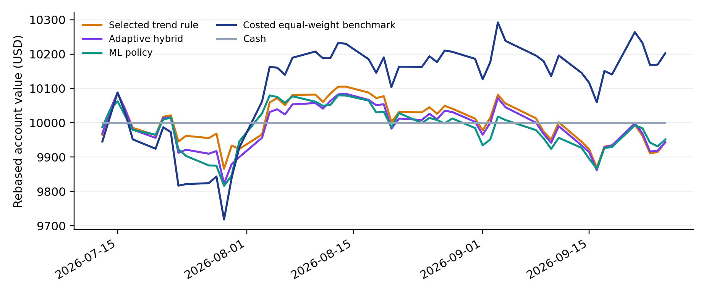

# Causal Rolling Models and Shared-Capital Execution: A Negative-Result Study of ML-TradeEngine

ML-TradeEngine project | Technical research manuscript | 28 September 2026

## Abstract

We evaluate whether a rolling hybrid classifier adds predictive or economic value after repairing accounting, chronology and execution mismatches in an experimental trading system. A protocol registered before a new public-data download specifies 22 US equities and ETFs, execution-aligned five-session labels, purged rolling training, a fixed logistic/tree mixture, and one constrained $10,000 account per policy. The recent historical audit contains 54 trading sessions, with 48 label-complete sessions. Hybrid accuracy is 37.59%, compared with 35.89% for always-UP and 40.63% for a trailing class-frequency baseline. The hybrid portfolio returns -0.56% after modeled costs, versus +2.03% for the identically costed, risk-capped equal-weight benchmark. No candidate satisfies the declared statistical eligibility gate. The contribution is a reproducible implementation and a documented negative result, not a demonstrated trading advantage. Prospective profitability and broker execution remain unverified.

## 1. Research question and contribution

The project has two distinct objectives: build a reliable simulated trader and establish a strategy whose performance warrants an empirical research claim. These objectives require different evidence. Accounting identities and recovery tests establish implementation properties; they cannot establish an economic edge. Conversely, an attractive return curve cannot validate an incorrect ledger or a future-informed model.

We ask whether rolling adaptation improves prediction beyond simple class-frequency baselines, whether a fixed blend of statistical and trend signals improves net portfolio performance, and whether the exact account contract can be reused in daily local simulation. The experiment is deliberately bounded: three trading candidates, no search after viewing the recent audit, and no extrapolation from simulated returns to real-money profits.

The earlier corrected classifiers achieved average accuracies of 30.26%-34.98%, below an always-UP baseline of 41.94%. Those findings motivated this new design. They remain part of the evidence record and are not replaced by a selectively reported favorable run. Repeated strategy searches can generate misleading apparent winners even without an intentional coding error [1].

## 2. Data and chronological design

Yahoo Finance daily OHLCV data were downloaded on 27 September UTC / 28 September Hong Kong into a separate versioned snapshot. All 22 instruments pass completed-session, freshness, uniqueness, finite-value and OHLC-range checks through 25 September 2026. That Friday is the latest completed US session at retrieval. Ten years were requested, and the shared observation calendar is used for portfolio construction. Raw and split/dividend-adjusted snapshots are retained with retrieval metadata and SHA-256 hashes.

The universe is AAPL, AMZN, BAC, DIA, GLD, GOOGL, GS, IWM, JPM, META, MSFT, NVDA, QQQ, SPY, TLT, TSLA, XLE, XLF, XLI, XLK, XLP and XLV. It mixes individual stocks and overlapping ETFs. It is a fixed, pre-existing project universe, not a survivorship-free sample of all listed securities. Exchange sessions and closing times follow the XNYS calendar; the standard core session ends at 16:00 Eastern [4].

| Stage | Dates | Use |
| --- | --- | --- |
| Development | 2 Jan 2024 - 31 Dec 2025 | Historical diagnostics; already exploratory |
| Selection | 2 Jan - 10 Jul 2026 | Choose one of three fixed policies by net Sharpe |
| Recent audit | 13 Jul - 25 Sep 2026 | Registered before new download; 54 sessions |
| Prospective pilot | From 29 Sep 2026 | 63 completed sessions; none yet observed |

The recent audit begins after the latest observation in any previously inspected cache. It is a held-aside extension relative to the available project artifacts, but remains retrospective: the design was registered after calendar events had occurred. It is not described as an untouched prospective experiment. A model may refit during the audit using only labels whose endpoints are already in the past; the frozen adaptive algorithm, rather than one frozen set of coefficients, is being evaluated.

## 2.1 Execution-aligned outcome

For a decision after close t, the first allowed fill is at close t+1. The prediction target is r(t) = Close(t+6) / Close(t+1) - 1. UP requires r(t) > 1%; DOWN requires r(t) < -1%; otherwise the class is FLAT. The final six rows have unavailable labels and are excluded from classification metrics. Consequently, 54 account sessions provide 48 labeled dates and 1,056 instrument-date classifications. The older screenshot used close-to-close labels starting at t, a different evaluation period, and mean per-ticker summaries; its percentages are not a like-for-like improvement benchmark.

## 3. Models, adaptation and portfolio execution

Seventeen scale-free features describe returns over 1, 5, 21, 63, 126 and 252 sessions; trailing volatility over 21 and 63 sessions; SPY-relative returns; price relative to 20-, 50- and 200-session means; overnight gap; high-low range; volume relative to its 20-session mean; and 12-minus-1-month momentum. All use information through the decision close. No revised macro data, unarchived news, full-sample HMM, or full-history feature selection enters this release.

Each instrument refits every 21 observations using at most 1,008 eligible rows. Labels must end strictly before the refit decision. The final 126 eligible rows are held out for calibration; a six-session purge separates fitting from calibration. At least 504 fitting observations are required. Scaling is fit on the fitting partition only. Chronological splitting and explicit gaps address the availability issue represented by time-series cross-validation tools [2].

The experts are multinomial logistic regression (C=0.1) and histogram gradient boosting (100 iterations, seven leaves, minimum leaf 40, learning rate 0.05, L2=10). Class weights are not balanced. Their probabilities are averaged equally, then temperature-scaled using the calibration partition and a fixed choice set {0.75, 1, 1.5, 2, 3}. The temperature minimizes calibration log loss. The prior baseline is the Laplace-smoothed fitting class frequency. We use calibration and scoring concepts described in the scikit-learn documentation [3]; no future observations fit the scaler, experts or calibrator.

The trend policy is long when price exceeds its trailing 200-session mean and 12-minus-1-month momentum is positive. The ML policy is long when its probability-weighted fitting class return exceeds 30 basis points. The adaptive hybrid is half trend and half ML only when calibration log loss improves on the prior by at least 0.01; otherwise it uses the trend rule. This gate is estimated on the same calibration block as temperature, so its internal performance can be optimistic. The outer audit measures the complete gate's behavior.

Each active symbol initially receives 0.8/22 of capital. Targets are capped at 80% gross, 10% per symbol and 35% for the declared growth group. A trailing 63-session covariance matrix with 50% diagonal shrinkage reduces targets when annualized volatility exceeds 12%. No leverage is introduced. Weekly Friday decisions execute at the next observed close; the initial decision is also eligible. Non-rebalance sessions process pending fills and risk marks without generating routine weight-maintenance trades. Turnover is capped at 40% per session, and a 20% account drawdown requests liquidation subject to execution constraints.

The ledger applies 10 basis points commission and 5 basis points slippage per side. Pending buys reserve cash, pending sales provide no buying power, and fees reduce cash. Equity equals cash plus marked positions; net realized profit includes entry and exit costs. Terminal positions remain marked. Cash earns zero; Sharpe uses a fixed 5% annual hurdle. Adjusted prices define total-return proxy units rather than executable broker shares. Daily local operation chains adjusted returns onto stored marks to remain invariant to uniform vendor rescaling.

## 4. Prediction results

Table 1 reports the recent audit. Accuracy measures the fraction of correct three-class labels. Balanced accuracy averages class recalls; its always-UP value is one third. Macro F1 gives each class equal weight. Log loss and the sum-of-classes multiclass Brier score evaluate probability quality; smaller values are better. Always-UP is nearly deterministic and therefore has very poor probability loss when its prediction is wrong. The probabilistic prior is the more informative comparison.

| Model | Accuracy | Balanced | Macro F1 | Log loss | Brier |
| --- | --- | --- | --- | --- | --- |
| Logistic | 38.35% | 37.89% | 0.378 | 1.129 | 0.686 |
| Shallow tree | 36.93% | 36.63% | 0.366 | 1.168 | 0.705 |
| Calibrated mixture | 37.59% | 37.24% | 0.372 | 1.088 | 0.659 |
| Trailing prior | 40.62% | 39.26% | 0.307 | 1.076 | 0.654 |
| Always-UP | 35.89% | 33.33% | 0.176 | 17.714 | 1.282 |

The hybrid is 1.70 percentage points above always-UP, but 3.03 points below the trailing prior. Its log loss of 1.088 also trails the prior's 1.076. The date-block 95% interval for the hybrid's accuracy improvement over always-UP is [-2.27, +5.30] percentage points. The interval contains zero. These diagnostic intervals are not adjusted for every model comparison and should not be promoted to discovery claims.

| Period | Hybrid accuracy | Always-UP | Trailing prior |
| --- | --- | --- | --- |
| Development | 41.14% | 42.86% | 43.68% |
| Selection | 37.52% | 39.86% | 40.21% |
| Audit | 37.59% | 35.89% | 40.62% |

The results illustrate why an absolute accuracy target is insufficient. Three-class frequency shifts change the difficulty of the task, while correct and incorrect predictions have unequal financial consequences. The new model is more causally aligned and adapts over time, but these properties do not establish predictive superiority. In this sample, a simpler rolling class-frequency estimate remains the strongest accuracy and probability benchmark.

## 4.1 Dependence and uncertainty

Classification uncertainty resamples 10-date circular blocks, retaining all instruments within each sampled date to preserve cross-sectional dependence. Portfolio evidence uses signed heteroskedasticity-and-autocorrelation-consistent active-return statistics and 1,000 circular block bootstrap samples. The trading gate requires a positive lower active-return interval and a one-sided p-value below 0.05 after a Bonferroni factor of 333: the 330 earlier declared comparisons plus three new policies. This is a conservative bookkeeping family, not proof that all informal historical researcher choices have been accounted for. We do not claim to implement the probability-of-backtest-overfitting estimator in [1].

## 5. Net portfolio results

The selection period chooses the trend rule (Sharpe 0.544) over the hybrid (0.509) and ML policy (0.017). This choice was fixed before inspecting audit outcomes. Each strategy has its own $10,000 shared-capital account running continuously from January 2024. The table reports period returns from those accounts, not averages of isolated ticker backtests.

| Policy | 2024-25 | Selection | Audit | Audit drawdown |
| --- | --- | --- | --- | --- |
| Selected trend | +29.66% | +4.69% | -0.57% | -2.34% |
| ML policy | +14.22% | +2.53% | -0.49% | -2.45% |
| Adaptive hybrid | +30.11% | +4.41% | -0.56% | -2.63% |
| Equal-weight benchmark | +41.06% | +7.85% | +2.03% | -3.67% |
| Cash | +0.00% | +0.00% | +0.00% | 0.00% |
| SPY reference | +47.84% | +11.30% | +2.43% | -3.38% |

Figure 1. Audit-period curves rebased to $10,000 for visual comparison. Rebased curves are not separately restarted accounts. The equal-weight comparator uses the same cash, cost, risk-cap and execution rules. SPY is a frictionless adjusted-price reference, not an identically executed account.

All three candidates have negative audit returns and adjusted active-return p-values of 1.0. For the selected trend policy, the 95% annualized active-mean interval is [-33.94%, +6.27%]; annualization of this short window produces substantial uncertainty. Doubling per-side costs changes audit returns to -0.65% (trend), -0.77% (ML) and -0.70% (hybrid). At four times costs they become -0.79%, -1.34% and -0.96%. No cost sensitivity case is used to select a new winner.

## 6. Implementation evidence and readiness

The experiment contains 726 rolling refits. Every recorded latest training-label endpoint precedes its decision. Five shared accounts produce 8,927 simulated fills, with a maximum absolute accounting residual of $2.18e-11 and minimum cash of $2,078.00. These checks establish arithmetic consistency in the tested replays, not market realism or prospective profitability.

The offline verification record reports 310 passing tests. Regression coverage includes future-data perturbation, label availability, purged fitting/calibration boundaries, model serialization and tampering, exact feature contracts, pending-cash limits, gap rejection, scheduled hold sessions, drawdown exits, retries, restart recovery, missed-session rejection and account reconciliation. A real-data commissioning run loaded all fresh model bundles and prepared the daily decision record. Before the reserved pilot start it creates no prospective fills.

A second run from archived source and snapshots reproduced every checked probability, account curve, metric, fold record and event record exactly.

| Readiness decision | Outcome | Meaning |
| --- | --- | --- |
| Software contract | approved for local simulation | Scope is the tested local simulation |
| Current data and models | Approved at release | 22 complete instruments through 25 Sep |
| Historical trading edge | Not approved | Audit eligibility tests fail |
| Prospective trading evidence | Not approved | Zero observed pilot sessions |
| Profitable trader / combined | Not approved | No defensible basis for approval |
| Broker execution | Not approved | No external orders or adapter certification |
| Research manuscript | Completed technical report | Negative results; not peer-reviewed acceptance |

The production-eligible local allocation is cash. A separately labeled research shadow may exercise the selected trend policy prospectively without implying qualification. The daily command verifies archived artifacts, retrieves current data, refreshes models on their fixed schedule, records targets and model hashes, and processes the same ledger contract as research. It refuses missing or stale inputs and refuses to backfill missed pilot sessions. Model updates are separate immutable versions. There are no broker, email or messaging calls in this release path.

## 6.1 Reproducibility package

The release directory data/releases/2026-09-28-adaptive contains the registered protocol, raw and adjusted market snapshots, dependency versions, archived training source, model manifests, fold cutoffs, probabilities, target panels, SQLite account states, full event histories, classification/portfolio tables and checksums. The daily CLI is trader.py; the current console is app.py. Reproduce the numerical study with scripts/reproduce_adaptive.py using a new output directory. The package records actual dependency versions; a clean-environment portability run across different library versions has not been claimed.

## 7. Limitations and interpretation

The central result is negative: this experiment does not establish a useful predictive advantage or a profitable strategy after costs. It does not prove that all ML strategies must fail. The models, universe, horizons and training budgets are limited, while the recent audit is only 54 trading sessions. A positive future result would still need uncertainty analysis and independent confirmation.

The fixed universe includes surviving stocks and ETFs selected before this experiment; overlapping funds introduce concentrated economic exposures beyond the explicit growth group. Portfolio covariance is estimated from a short trailing window. The data provider's adjusted history is a current-vintage reconstruction rather than an immutable historical feed. Scale-free features and stored snapshots improve auditability, but cannot prove that every observation was available in exactly that form at its historical timestamp.

The execution model assumes next-close fills, fixed proportional costs and fractional total-return proxy units. It does not model closing-auction participation, spread dynamics, volume impact, taxes, borrow, market halts or cash corporate-action processing in a broker account. A drawdown threshold requests reduction after observation; it does not guarantee a maximum realized loss. Drift can temporarily move marked exposure beyond a target cap. External execution requires a dedicated adapter, verified timing and corporate-action reconciliation.

The prospective 63-session pilot is reserved from 29 September 2026 and has not occurred. No generated report, statistical threshold or test count can substitute for observing it. If the algorithm is changed after seeing pilot results, it becomes a new registered experiment. The current manuscript is complete as an implementation-and-negative-result technical study. It does not support a title, abstract or conclusion claiming consistent profits, verified alpha, novel market prediction, or production broker readiness.

## References

[1] Bailey, D. H., Borwein, J. M., Lopez de Prado, M., and Zhu, Q. J. The Probability of Backtest Overfitting. Author manuscript. https://www.davidhbailey.com/dhbpapers/backtest-prob.pdf

[2] scikit-learn. TimeSeriesSplit documentation, including chronological folds and gap. https://scikit-learn.org/stable/modules/generated/sklearn.model_selection.TimeSeriesSplit.html

[3] scikit-learn. Model evaluation and probability calibration documentation. https://scikit-learn.org/stable/modules/model_evaluation.html and https://scikit-learn.org/stable/modules/calibration.html

[4] New York Stock Exchange. Trading information and core-session hours. https://www.nyse.com/trade/trading-information

[5] ML-TradeEngine. Registered adaptive protocol, 28 September 2026; immutable run artifacts and source manifests. docs/ADAPTIVE_PROTOCOL_2026-09-28.md; data/releases/2026-09-28-adaptive/.
